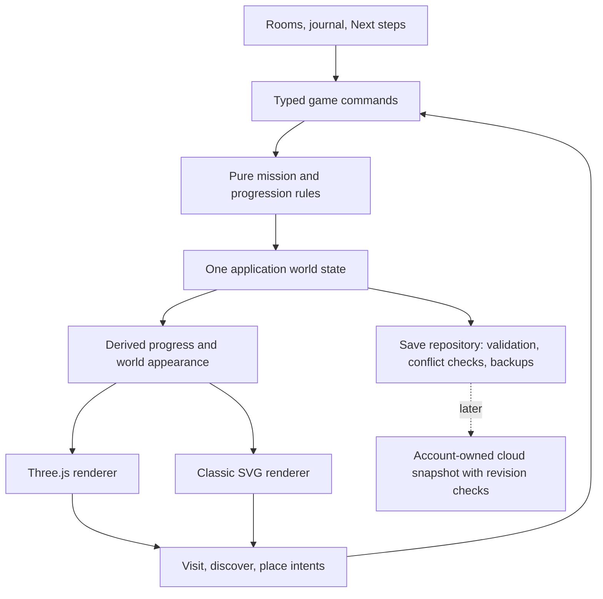

# MyVerse architecture review

Reviewed 2026-10-16 against `553caa7` on `main`. The audit below records that baseline; execution progress is tracked here. The owner has approved the new natural landscape direction.

**2026-10-17 execution checkpoint:** milestone A is implemented in `saveRepository.ts`, `useGameSession.ts`, `SaveStatus.tsx` and the coordinated WorldTools flow. Seventeen new tests cover concurrency and recovery; that checkpoint had 81 tests. Browser checks exercised two real competing tabs, conflict review/download/load, retained-session recovery, stale confirmation, file/pasted restore, newer-format protection, Focus reset, reload and a narrow CSS viewport. See ROADMAP.md for evidence and limits.

**2026-10-18 execution checkpoint:** the first part of B is implemented: `workshopAppearance` resolves active selection/stage, and the engine reuses Workshop geometry across unrelated edits and same-stage selections. React supplies save and selection together, including construction. Five new regression tests bring the suite to 86. A deterministic localhost fixture measured 40 unnecessary rebuilds becoming zero (about 7.6 seconds versus 1.9 milliseconds of synchronous update CPU time in this browser). Twelve-second Quality/Eco cadence samples and ten renderer cycles are recorded in [the benchmark report](docs/performance/2026-10-18-workshop.md). These are bounded browser measurements, not device/FPS guarantees. Asset delivery, cold/throttled loads and representative device budgets remain the next B work; C–D remain proposed.

**Recommendation:** strengthen save safety, remove unnecessary scene work, then connect the existing features into a short daily routine. Keep React, TypeScript, Vite, Three.js, the shared mission model and Classic view. The current scale does not justify a framework rewrite, a generic game engine or separate services.

## Evidence and scope

Inspected the application state, save validation/persistence, Focus, growth rules, world adapters, rendering lifecycle, CI and roadmap. Reproduced the stale-tab overwrite using the existing functions and an in-memory storage object. No browser storage was accessed or changed. No new visual/device benchmarks or full test run were performed for this document; the 64-test checkpoint and browser results are recorded in [ROADMAP.md](ROADMAP.md).

The existing strengths are worth preserving: one mission identity across rooms, derived XP, pure progression functions, original-save migration backups, explicit restore recovery, scene cleanup, actual-triangle terrain contact, local licensed assets, reduced motion and a playable Classic fallback.

## Prioritized gaps

| Priority | Evidence in current code | Consequence | Proposed response |
| --- | --- | --- | --- |
| P1: save concurrency | [App.tsx](src/App.tsx), `readCurrentGame` / `updateSave`; [game.ts](src/game.ts), `persistGame` | Each tab keeps its own snapshot. A stale valid snapshot can silently replace newer work in the same origin. | Centralize writes, coordinate tabs and expose conflict recovery before adding cloud sync. |
| P1: unnecessary 3D rebuilds | [experience.ts](src/world/three/experience.ts), `update`, lines 808–819; [models.ts](src/world/three/models.ts), `makeWorkshop` | The rebuild key includes every project and every mission's completion. Renaming another project or completing an unrelated mission rebuilds the selected Workshop, whose geometry depends on its stage. | Give the renderer a small derived snapshot. Rebuild only when the relevant visual state changes. |
| P1 before public release: delivery/device budget | [natural-materials.ts](src/world/three/natural-materials.ts); [experience.ts](src/world/three/experience.ts), renderer setup / `eco` | All 12 photographic maps load even in Eco; source files total 9,377,462 bytes. Eco reduces render cost, not this download. Quality starts with 2048px shadows, reflections and postprocessing. Physical phone performance is unknown. | Measure a fixed scene, optimize asset delivery, then introduce conservative automatic quality with a manual override. |
| P2: daily-use flow | [App.tsx](src/App.tsx); [FocusStudio.tsx](src/FocusStudio.tsx); [WorldTools.tsx](src/WorldTools.tsx) | Missions, Focus, projects and garden exist, but users must choose and connect them themselves. There is no small persisted shortlist or contextual Start focus action on a mission. | Add a maximum-three-item Next steps list and direct Focus entry, reusing mission IDs. Validate the benefit with real use. |
| P2: lifecycle/history | [game.ts](src/game.ts), `Entry` / `totalXP`; [growth.ts](src/growth.ts) | Mission/idea archive is absent; completion dates are unknown. Deleting completed missions would reduce XP and can invalidate placed rewards. Accurate weekly history cannot be reconstructed. | Define archive and completion-history semantics before implementing deletion, habits or reflection. |
| P2: permanent identity | [models.ts](src/world/three/models.ts), `makeWorkshop`; [growth.ts](src/growth.ts), stage/achievement thresholds | Projects share one selected model. Three plants reach their final stage at six assigned completions; Starfall has one chapter. The world has limited ways to show a user's longer personal history. | Add one persistent, named keepsake for a completed project after the daily loop works. Test whether this gives users a reason to return. |
| P2: responsibility boundaries | [App.tsx](src/App.tsx), 739 lines; [experience.ts](src/world/three/experience.ts), 913 lines; [models.ts](src/world/three/models.ts), 1006 lines | Save writes, commands, feedback and modal state are coupled; the engine combines input, animation, construction and updates. Size alone is not a defect, but unrelated changes share these files. | Extract the boundaries touched by each milestone. Avoid a repository-wide rename/refactor pass. |
| P2: repeatable release checks | [.github/workflows/checks.yml](.github/workflows/checks.yml); [tsconfig.app.json](tsconfig.app.json) | CI runs unit tests/lint/build but no browser flows. TypeScript `strict` is not enabled. Documented manual QA cannot automatically catch future dialog, save or canvas regressions. | Add a small browser smoke suite; enable strict checking in an isolated, measured change. Keep physical device QA as a separate gate. |

### Confirmed save-loss example

Two sessions read the same empty world. A saves completed mission `a`; stale B saves mission `b`. Both `persistGame` calls report success, but the stored world contains only `b`. This was reproduced in memory against the current source. Validation protects unreadable/newer formats; it does not detect a different, valid world written by another tab.

Scope: tabs sharing an origin. `localhost:5173` and `127.0.0.1:5173` intentionally remain separate worlds for QA.

## Target structure, introduced gradually

- **Domain:** retain the existing pure functions in `game.ts`, `growth.ts`, `starfall.ts` and `focus.ts`. Consolidate creation/rename/completion rules so every entry point uses the same validation. A command returns the next world plus user feedback; renderers never award XP.
- **Application state:** extract `useGameSession` from App to own the accepted world, unsaved session state, command queue, save status and restore lifecycle. A reducer/custom hook is sufficient initially. Separate transient screen state from saved progress; use one typed active-overlay state instead of independent room-open booleans as dialogs are touched. Focus can continue while its dialog is minimized.
- **Persistence:** a `saveRepository` owns ordinary writes, migration backups, restore/recovery and external-change detection. Components call it through the session layer. Return explicit states such as saved, saving, conflict, unavailable and protected-format rather than an ambiguous empty string.
- **Rendering:** introduce a typed `WorldAppearance` selector containing avatar appearance, selected project identity/stage, garden stages, story state and decoration placements. Bind 3D/Classic props to a shared world contract instead of deriving the 3D API from `ComponentProps<typeof IslandWorld>`. Share progress and destination definitions; keep camera mechanics specific to each renderer.
- **Assets/runtime:** retain world-owned photographic textures and explicit disposal. Split scene construction, input/navigation and visual updates as those areas change. Keep canonical destination positions/colliders separate from display meshes so future art replacements remain walkable.

## Next execution milestone A: safe concurrent saves

Deliver a focused safety improvement with the current v3 payload and `myverse-save-v1` key intact. No cloud or new progression schema in this milestone.

1. Retain the exact last accepted raw save as the session's base token. Serialize commands within a tab.
2. For every ordinary write, acquire the same origin-scoped exclusive Web Lock, re-read storage, validate it and compare it with the base token inside the lock. A changed token is a conflict; do not silently write the older session over it.
3. Route explicit restore/recovery through the same coordinator. Capture the current raw original and the in-memory session before replacement as today. Recheck a restore preview's base at confirmation; if it changed, refresh the preview before replacing anything.
4. Observe external storage changes and recheck on resume. A clean session can accept a validated external world; a dirty session must retain its work and show recovery choices. Invalid/newer external data stays protected. Reconcile an attached Focus mission when accepting a different world.
5. Provide Download this session and Load saved world choices. Loading over unsaved work needs a concrete confirmation. Explicit replacement continues to use previewed restore and backups; no automatic merge of whole worlds.
6. If locking is unavailable, fail closed for durable writes and clearly offer session editing/export rather than claim concurrency safety. This is a deliberate fallback to validate against supported browsers. Existing old clients that do not participate in locking remain outside the concurrency guarantee.
7. Saving may become asynchronous: keep pending commands ordered, report pending/unsaved status honestly, and prevent a late result from an earlier world applying after a restore. A small generation token is sufficient; no event-sourcing system is needed.

Web Locks coordinate cooperating same-origin tabs; `storage` events notify other contexts after a change. An event listener or compare-then-write without coordination is not an atomic write protocol. See [Web Locks API](https://developer.mozilla.org/en-US/docs/Web/API/Web_Locks_API) and [storage event](https://developer.mozilla.org/en-US/docs/Web/API/Window/storage_event).

**Acceptance:** sequential stale writes and near-simultaneous writes preserve the newer save or surface a conflict; no silent loss. Test two independent tabs on localhost, ordinary writes racing restore, pending commands during restore, old migrations, corrupt/newer saves, storage failure, both recovery copies and repeated completion for exactly one XP award. Keep the owner's 127.0.0.1 world untouched. Commit/push this milestone separately once tests, build, lint and browser checks pass.

## Next execution milestone B: scene efficiency

**First checkpoint complete:** the Workshop selector/rebuild key now uses actual visual inputs. Same-stage project switches retain geometry while updating identity; display text remains in React. Unrelated mission/project edits allocate/dispose no Workshop model. A selected task that crosses a build stage replaces it once. Keep this invariant when adding future visuals.

Then measure a deterministic populated QA world using a fixed camera route, cold/warm asset loads and a sustained session. Record device/browser, frame-time percentiles, transfer bytes, draw calls/triangles and resource counts. Include reflected and non-reflected frames. Browser frame cadence alone is not a GPU timing measurement.

Provisional targets, to calibrate on named devices: usable mission controls within 2 seconds on a defined throttled connection; usable lightweight world within 5 seconds; sustained 30 fps or better in the chosen phone quality mode; stable texture/geometry counts after ten world/room switches. These are proposed budgets, not current results. A 60 fps desktop target is desirable after a representative baseline exists.

Optimize measured costs in order: unnecessary rebuilds, photographic transfer/decode, foliage/geometry detail by distance, reflection/shadow cost. Keep a usable procedural first frame. Separate quality level from asset readiness so Eco can actually request a smaller asset set. Preserve source/license records when generating compressed variants and visually inspect normal-map colour handling. Any future automatic quality changes need a settling period to avoid oscillation; user selection wins. No new renderer framework is required.

## Next product milestone C: Next steps and organisation

**User flow:** open MyVerse → see up to three chosen missions → start Focus directly on one → explicitly complete the real task → see which project/plant changed → return later to the remaining shortlist.

- The shortlist stores ordered existing mission IDs. It does not copy tasks, grant XP, impose a deadline or reset at midnight. Adding/reordering is explicit; completion removes that mission from the active shortlist. Empty state offers Add a small step or Choose an existing mission.
- Focus accepts an optional initial mission ID. An existing running session requires an explicit choice before replacement. Timer expiry still grants no XP.
- Add archive/reopen for missions and ideas. Archived missions remain in the saved mission collection and still count toward earned XP, garden credit and existing project references. Project archiving does not automatically archive its shared missions. A referenced archived mission remains visible in its project with an archive indicator and a reopen action.
- If task cancellation is desired later, design it separately: archive only hides an item from ordinary lists and does not silently complete or remove a required project task. Hard deletion and completion undo need their own earned-progress policy.
- Use one shared mission-list presentation for search/status/archive/pagination where behaviour is genuinely identical. Keep room-specific artwork and interaction.
- Show pending/failed save state beside the action, not only below the island. Keep keyboard focus on a useful next control after completion/archive.

This milestone introduces durable lifecycle fields. Prepare an explicit **v4 migration design** before implementation instead of silently extending v3 indefinitely. Keep the storage key and original v1/v2/v3 backups. Proposed fields: optional archive status, ordered shortlist IDs and creation/completion timestamps for new actions. Legacy timestamps are unknown, never invented. Date-based reflection must say when tracking began. Preserve all IDs, project links, XP, decorations, story and earned achievements. Old v3 clients must reject the newer format before writing.

**Acceptance:** shortlist survives reload/export/restore; complete the same shared task from two views for +25 XP once; archiving preserves earned progress and references; Focus uses the selected mission; keyboard/393px layouts work. Test a large fixture to keep lists usable. Ask a few people to complete the flow without coaching before treating retention as proven.

## Later milestone D: projects leave a lasting mark

Add one small named project keepsake at a dedicated world spot, with a matching accessible gallery entry. Its record references the project ID and remembers the earned completion even if the project is archived or expanded later. Decide its award rule alongside the existing Builder achievement. Start with a few reusable forms/materials and a bounded visible selection; do not create an unbounded mesh for every completed task.

The art direction is now natural terrain with fantasy character/story elements. Preserve that accepted direction. Character movement/animation, a coherent building kit and the exterior-to-interior transition are higher-value candidates for the next art pass than another layer of scenery. Commission/import bespoke assets only with a defined scale, ground anchor, interaction bounds, material budget and license record. Blender can serve that asset pipeline when needed; it is not a prerequisite for the safety and daily-use milestones.

## Public-release gate and cloud direction

Add browser smoke tests for creation → shared completion → reload, restore/recovery, two-tab conflicts, dialog keyboard use and 3D/Classic switching. Keep renderer-specific checks separate from progress checks so software-rendering availability in CI is reported honestly. Physical touch gestures, representative GPU performance and screen-reader navigation still require explicit validation. Introduce TypeScript strict checking in a dedicated change after inventorying errors.

A small guest-only preview can precede accounts once basic safety/performance are acceptable. Before promising multi-device durability, design Supabase authentication and an account-owned world record with schema version, revision and validated payload. The initial cloud unit can be one world snapshot: update only against the expected server revision, handle retried requests, and show an explicit conflict instead of last-write-wins. Separate two-tab browser coordination from server concurrency; a browser lock does not coordinate devices. Enforce ownership on the server and never expose privileged credentials in the client.

Import a local world into an account through a preview, preserve local recovery, and test sign-out/account-switch boundaries. Download alone is not offline application support; cache/update strategy needs a separate decision before claiming that. Avoid social/multiplayer, AI planning, recurring habits and more islands until the core daily loop and recovery behaviour have been exercised by real users.

## Sol 6.1 handoff

Milestone A and the first Workshop-reuse checkpoint of B are complete. For the next execution pass, continue **milestone B only**: re-read AGENTS.md, this review and the benchmark report, then verify the repository state. Measure cold/throttled delivery before choosing photographic asset variants or quality changes; the warm-cache browser cadence sample is not a physical phone baseline. Keep procedural first-frame fallback, shared-map ownership/license records, v3 saves and the save coordinator intact. Do not add C–D opportunistically. Run appropriate tests, production build, strict lint and isolated browser QA; commit/push the verified milestone without force-push. Report remaining limitations explicitly.

Use Astra for architecture choices, migration/conflict design and review at milestone boundaries; use Sol for the scoped implementation, tests and delivery. This is a workflow recommendation, not a claim that either model is restricted to one kind of work. [Official model guidance](https://developers.openai.com/api/docs/guides/latest-model) positions Astra for the most demanding work and Sol 6.1 for complex work with a different speed/cost tradeoff; API pricing does not translate directly into a ChatGPT usage-window percentage.
